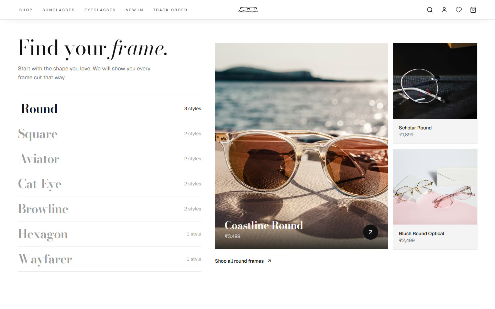
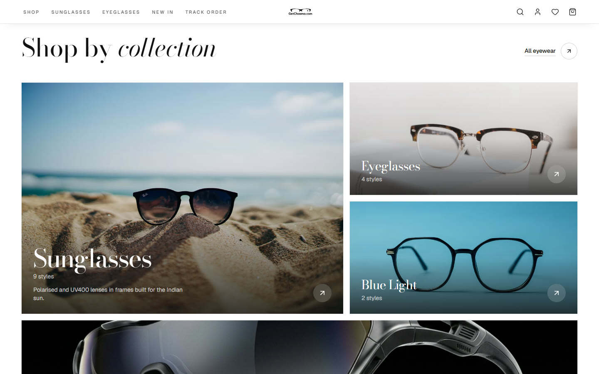
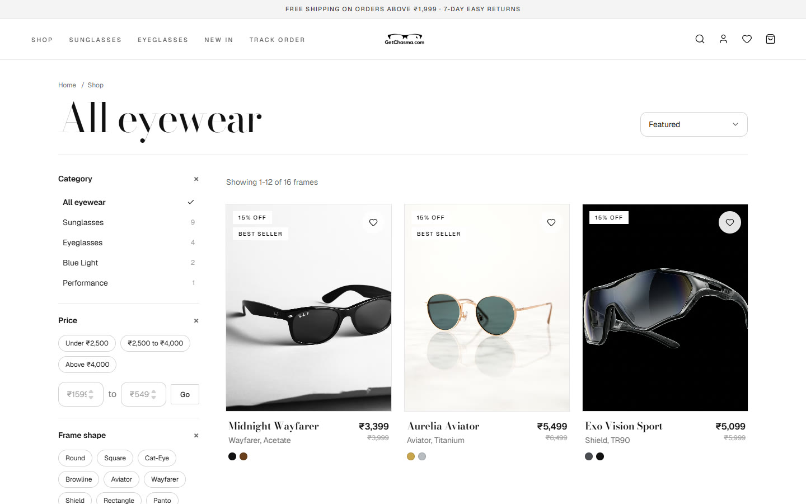
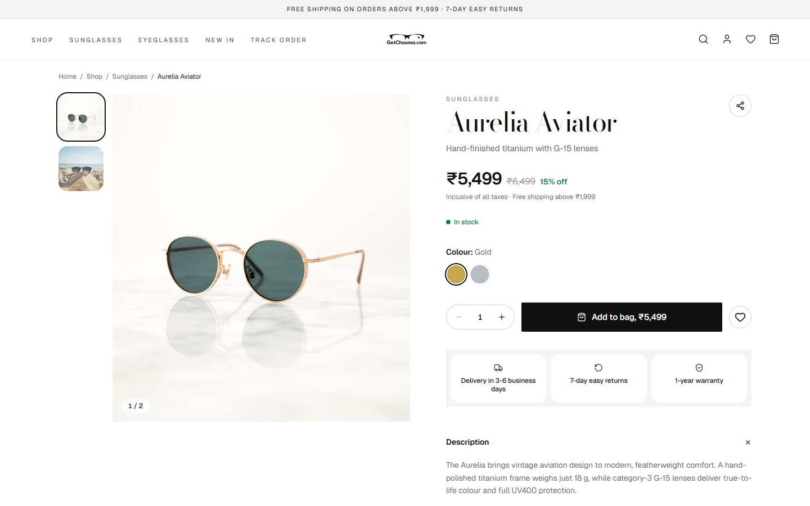
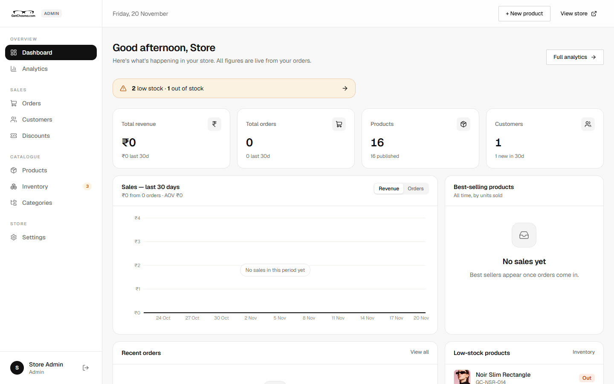
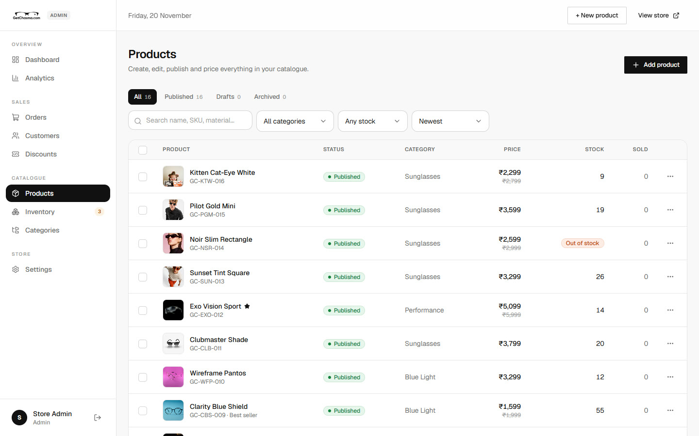
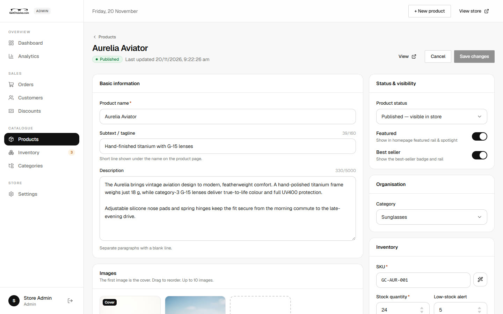

<div align="center">

<picture>
  <source media="(prefers-color-scheme: dark)" srcset="docs/logo-light.webp" />
  
</picture>

# GetChasma

**Perfect glasses for your unique style.**
A complete eyewear e-commerce platform: a premium storefront and a full admin dashboard, built on React and Express.

[**Live store**](https://getchasma.onrender.com) &nbsp;·&nbsp; [**Admin**](https://getchasma.onrender.com/admin) &nbsp;·&nbsp; [Quick start](#quick-start) &nbsp;·&nbsp; [Deploy on Render](#deploy-on-render)


<br />


</div>

---

## Overview

GetChasma is a full-stack store for sunglasses, eyeglasses and blue-light frames, designed in the classic luxury
eyewear tradition: white pages, editorial photography, a high-contrast serif and quiet black-and-white controls.

| | |
| --- | --- |
| **Storefront** | Editorial homepage, shape-based frame finder, filterable catalogue, product pages with gallery and zoom, cart, discount codes, checkout, order tracking, customer accounts and wishlist |
| **Admin dashboard** | Live KPIs and analytics, product management with multi-image upload, order workflow with refunds, inventory with movement history, customers, categories, discount codes, store settings and team roles |
| **Backend** | Express REST API, persistent SQLite storage, JWT cookie sessions, zod validation, secure image uploads, server-side pricing |

## Screenshots

<table>
  <tr>
    <td width="50%"><br /><sub><b>Find your frame:</b> browse by frame shape</sub></td>
    <td width="50%"><br /><sub><b>Collections:</b> category tiles managed from the admin</sub></td>
  </tr>
  <tr>
    <td><br /><sub><b>Shop:</b> filters for category, shape, price, colour, material and stock</sub></td>
    <td><br /><sub><b>Product page:</b> gallery, colours, stock, quantity and wishlist</sub></td>
  </tr>
  <tr>
    <td><br /><sub><b>Lookbook:</b> campaign looks linked to the frames that create them</sub></td>
    <td><br /><sub><b>Admin dashboard:</b> every figure computed from real orders</sub></td>
  </tr>
  <tr>
    <td><br /><sub><b>Products:</b> search, filters, bulk publish and archive</sub></td>
    <td><br /><sub><b>Product editor:</b> images, pricing preview, colours, SKU and stock</sub></td>
  </tr>
</table>

<p align="center"><br /><sub>Fully responsive, with a mobile tab bar</sub></p>

## Features

### Storefront
- **Editorial homepage:** campaign hero slideshow, shape explorer, collection tiles, a scroll-driven best-seller gallery, signature product story, lookbook, curated product tabs, reviews and newsletter.
- **Catalogue:** URL-driven filters (category, frame shape, price, colour, material, gender, availability, sale), sorting, search and pagination.
- **Product pages:** multi-image gallery with zoom, colour selection, real stock indicators, quantity, wishlist and related products.
- **Cart and checkout:** cart drawer and page, discount codes, free-shipping meter, server-priced checkout with inclusive GST, cash on delivery, and Razorpay ready to switch on.
- **After purchase:** order confirmation, guest order tracking (order number + email), customer accounts with order history and cancellation, wishlist synced to the account.

### Admin dashboard (`/admin`)
- **Dashboard and analytics:** revenue, orders, average order value, customers, sales over time, category and status breakdowns, top products and customers, repeat-buyer rate.
- **Products:** create, edit, delete, publish or unpublish, bulk actions, multi-image upload with drag-to-reorder and alt text, colours, pricing preview, SKU generator, unsaved-changes guard.
- **Orders:** search and filters, status workflow (Pending, Confirmed, Processing, Shipped, Delivered), cancellations with restock, full and partial refunds, tracking numbers, internal notes, timeline, CSV export.
- **Inventory:** add, remove or set stock with reasons, low-stock alerts, complete movement history.
- **Customers, categories, discounts and settings:** customer profiles and lifetime spend; category images and product assignment; percentage or fixed codes with dates, minimums and usage limits; store, branding, shipping, tax, payments, testimonials and team roles.

### Roles

| | Admin | Staff |
| --- | :-: | :-: |
| Products, categories, inventory, orders, customers, discounts | ✅ | ✅ |
| Delete products, categories and discounts | ✅ | |
| Issue refunds | ✅ | |
| Edit store settings, manage team | ✅ | read-only |

## Tech stack

| Layer | Technology |
| --- | --- |
| Frontend | React 19, Vite 8, Tailwind CSS v4, Motion, TanStack Query, React Router 7, Recharts, Sonner, Lucide icons |
| Typography | Bodoni Moda (display) and Geist (UI), self-hosted via Fontsource |
| Backend | Node.js 22.13+, Express 5, `node:sqlite`, zod, bcryptjs, jsonwebtoken, multer, helmet, express-rate-limit |
| Payments | Cash on delivery; Razorpay (orders, signature verification, refunds) once keys are configured |
| Hosting | Render, as a single web service serving the API, uploads and the built frontend |

## Project structure

```
.
├── backend/
│   ├── server.js            entry point (creates the first admin, seeds an empty catalogue)
│   ├── src/
│   │   ├── app.js           middleware, routes, uploads, serves frontend/dist
│   │   ├── config.js        environment configuration
│   │   ├── db/              schema.sql, connection, seed, bootstrap
│   │   ├── services/        products, orders (pricing, stock, lifecycle), payments, settings
│   │   ├── routes/          store.js (public), account.js (customers), admin/* (dashboard API)
│   │   ├── middleware/      auth and roles, validation, uploads, errors
│   │   └── lib/             schemas, passwords, helpers
│   └── test/api.test.js     end-to-end API tests on an isolated database
├── frontend/
│   └── src/
│       ├── components/      ui/ (design system), layout/, home/, product/, cart/, order/
│       ├── pages/           storefront pages
│       ├── admin/           admin dashboard (separate lazy-loaded bundle)
│       ├── context/         cart, wishlist, customer session
│       └── lib/             API client, formatting, queries
├── docs/screenshots/
└── render.yaml              Render blueprint
```

## Quick start

Requires **Node.js 22.13 or newer** (the built-in `node:sqlite` module is used, so there is no database server to install).

```bash
git clone https://github.com/cbharshainfinity07/Getchasma.git
cd Getchasma
cp backend/.env.example backend/.env   # then set ADMIN_EMAIL, ADMIN_PASSWORD and JWT_SECRET
npm run setup                          # installs everything and seeds the catalogue
npm run dev                            # API on :5001, storefront on :5173
```

Open http://localhost:5173 for the store and http://localhost:5173/admin for the dashboard.

| Script | What it does |
| --- | --- |
| `npm run dev` | API and Vite dev server together |
| `npm test` | API test suite (11 end-to-end tests) |
| `npm run lint` | Lint the frontend |
| `npm run build` | Install production dependencies and build the frontend |
| `npm start` | Start the production server (API + built site on one port) |

## Deploy on Render

The app runs as **one Render web service**. Express serves the API, uploaded images and the built React app from the same origin, so session cookies just work.

| Setting | Value |
| --- | --- |
| Runtime | Node |
| Build command | `npm run build` |
| Start command | `npm start` |
| Health check path | `/api/status` |

**Environment variables** (Render dashboard, Environment tab):

| Variable | Required | Notes |
| --- | :-: | --- |
| `NODE_ENV` | Yes | `production` |
| `JWT_SECRET` | Yes | A long random string (64+ characters). Set it **before** `NODE_ENV=production`, or the server will refuse to start. |
| `ADMIN_EMAIL` | Yes | Email for the first admin account |
| `ADMIN_PASSWORD` | Yes | At least 10 characters. Only used to create the first admin; change it later in Admin, Settings. |
| `RAZORPAY_KEY_ID`, `RAZORPAY_KEY_SECRET` | No | Turns on online payments. Without them, checkout offers cash on delivery only. |
| `DATABASE_FILE`, `UPLOAD_DIR` | No | Point these at a persistent disk (see below). |

`render.yaml` describes the same setup as a [Render Blueprint](https://render.com/docs/blueprint-spec).

> [!IMPORTANT]
> **Data persistence on Render.** Free Render instances have an ephemeral filesystem: the SQLite database and uploaded
> images are reset on every deploy and restart, and free instances restart after about 15 minutes idle. The starter
> catalogue is re-seeded automatically, so the demo always works, but orders, customers and admin edits will not survive.
> For a live store, use a paid instance with a **persistent disk** mounted at `/var/data` and set
> `DATABASE_FILE=/var/data/getchasma.db` and `UPLOAD_DIR=/var/data/uploads`.

## Security

- Passwords hashed with bcrypt (cost 12); timing-safe login; rate-limited admin and customer authentication.
- Separate httpOnly, SameSite=Lax session cookies for admin and customers, so a customer session can never reach admin APIs.
- Every request body validated on the server with zod. Prices, discounts, shipping and tax are always recomputed server-side.
- Stock decrements are atomic, which prevents overselling under concurrent checkouts.
- Image uploads limited to JPG, PNG, WebP and AVIF, size-capped, verified by file signature, stored under random names.
- Helmet security headers; admin API responses are never cached.

## Status and roadmap

| | |
| --- | --- |
| ✅ Working | Storefront, cart, checkout with cash on delivery, accounts, order tracking, full admin, analytics, API tests |
| ⚙️ Ready, needs keys | Razorpay online payments (add `RAZORPAY_KEY_ID` and `RAZORPAY_KEY_SECRET`) |
| 🔜 Not built yet | Razorpay webhook for late payment confirmation, order emails, prescription upload |

The catalogue uses brand photography from `frontend/public` plus stock eyewear photos from Unsplash; replace them from the
admin product editor. The three homepage testimonials and the `WELCOME10` code are sample content.

---

<p align="center"><sub>© GetChasma.com · Website developed by <a href="http://antmark.in">Antmark.in</a></sub></p>
